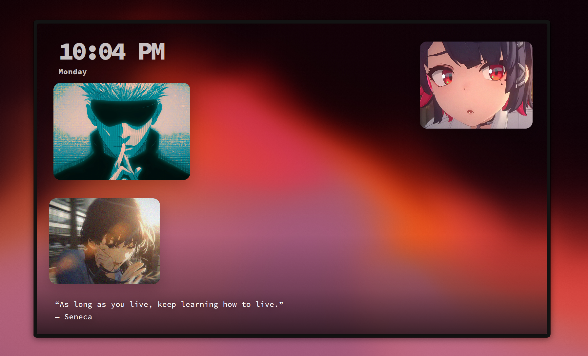
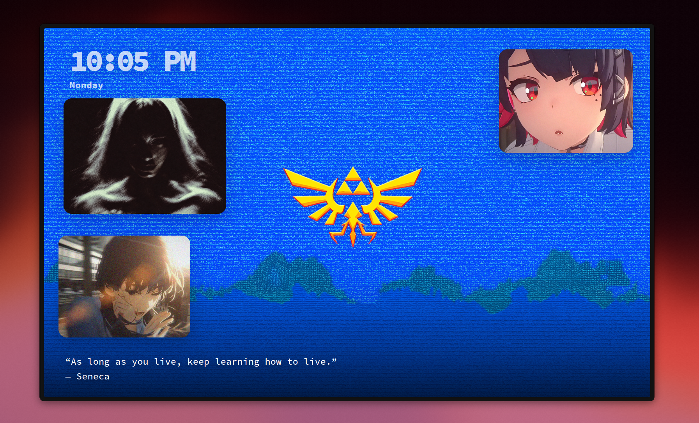

# New Tab

A personal start page with wallpapers, draggable photo widgets, a clock, and quotes.
Built with React and Vite.





## Use

Right-click the background to change the wallpaper or add a widget. Drag photos
around, or right-click a widget to resize it, change its image, or remove it.
Upload your own images through the gallery.

Your photos and settings stay in your browser. No accounts, uploads to a server,
or syncing. Clearing site data removes your saved collection.

To use it for new tabs, point a custom new-tab URL extension at your hosted address.

## Run locally

Requires Node.js 22.12+ (or 20.19+ within Node 20).

```sh
npm ci
npm run dev
```

Run `npm test` for tests, `npm run build` for a production build, and
`npm run preview` to preview it locally.

## Deploy

Import the repository into Vercel using the Vite preset. Build settings are
included in `vercel.json`. No environment variables or backend needed.

## License

Code: [MIT](LICENSE). Wallpaper permissions and favicon credits: [ASSETS.md](ASSETS.md).
